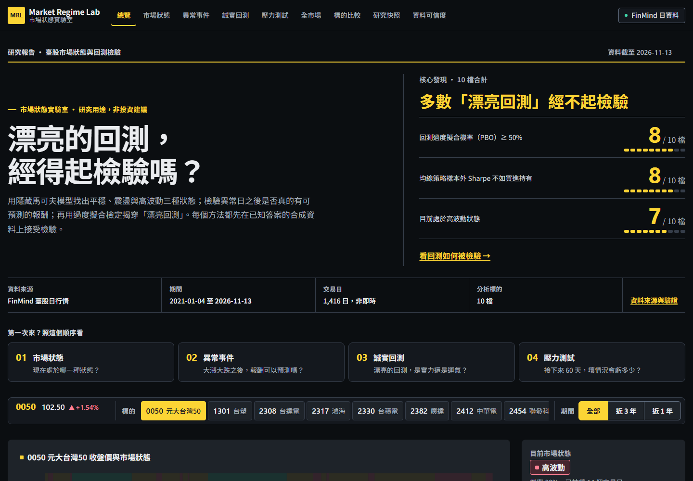
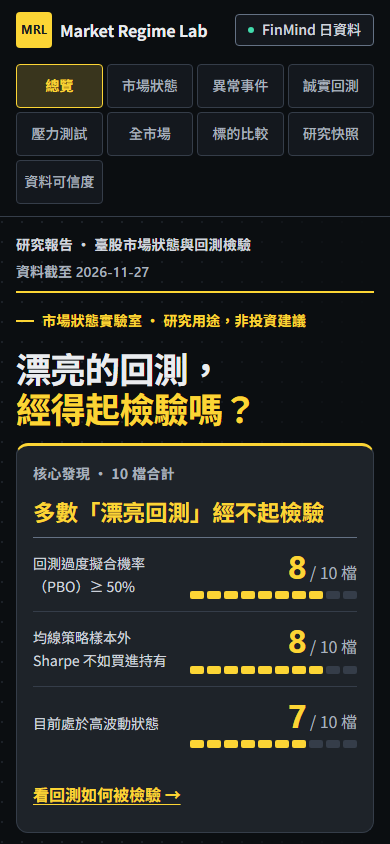
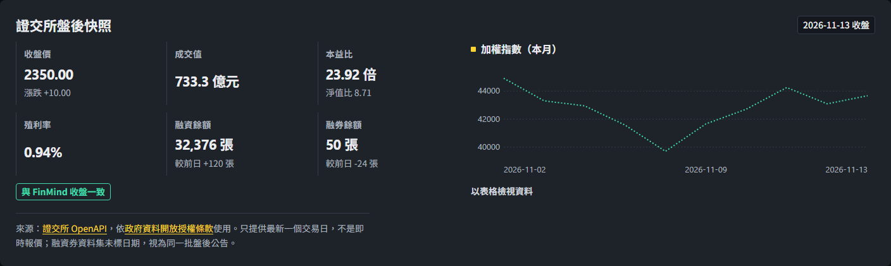
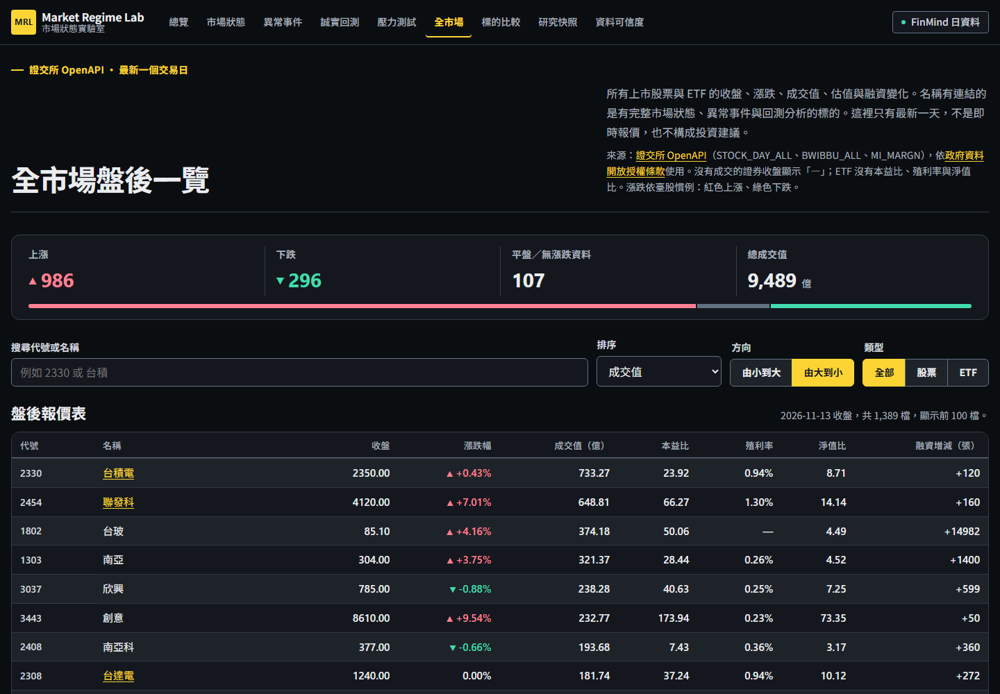
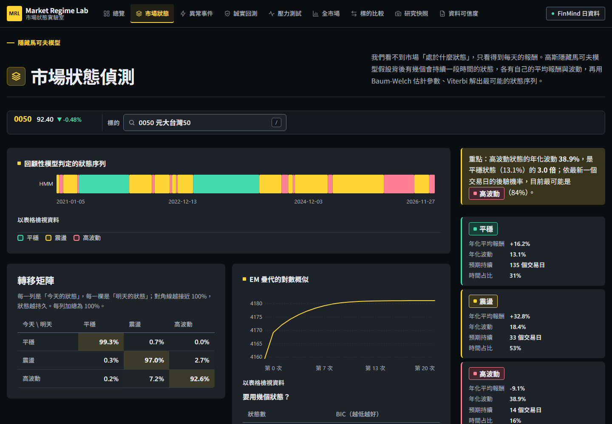
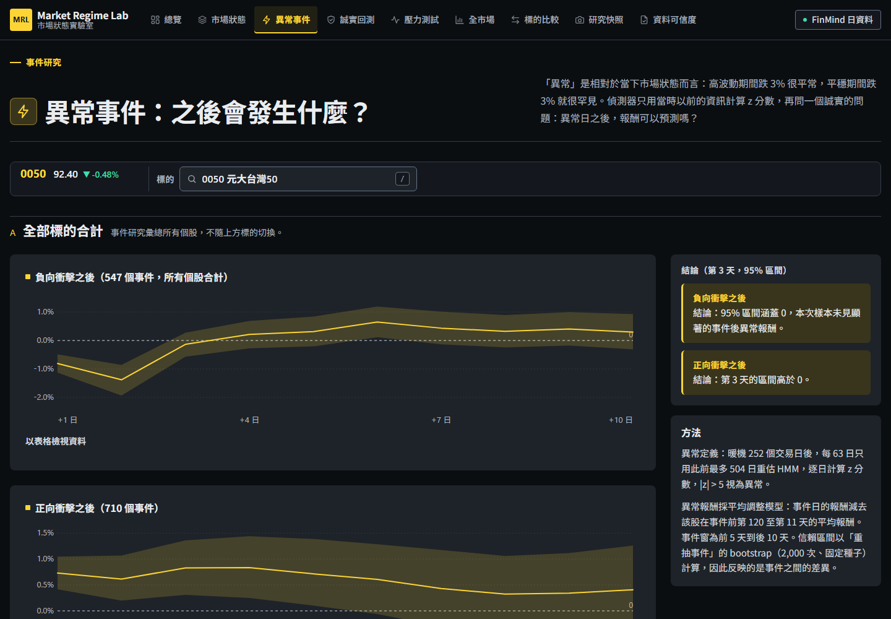
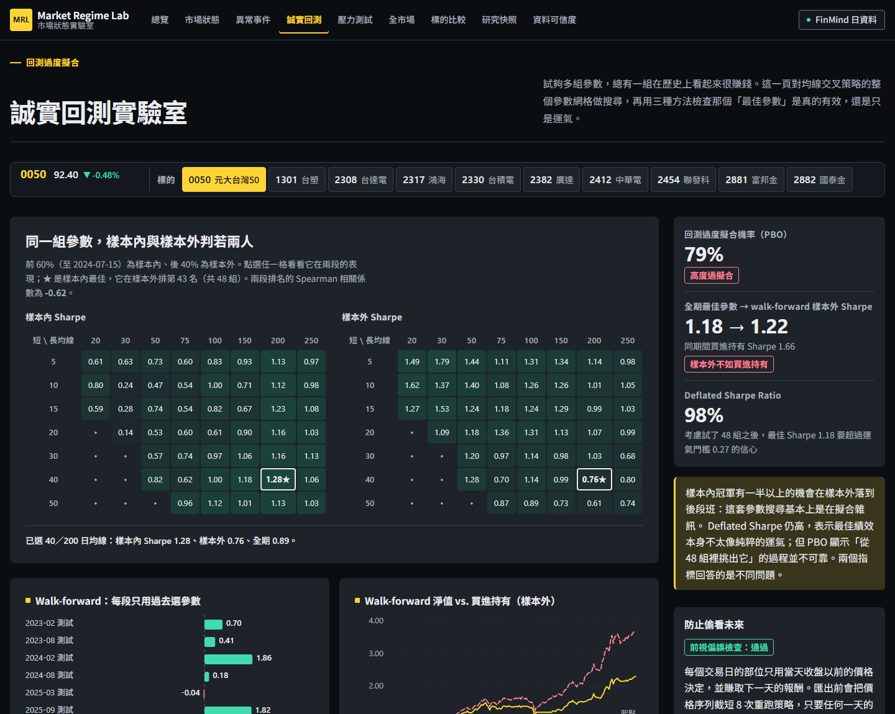
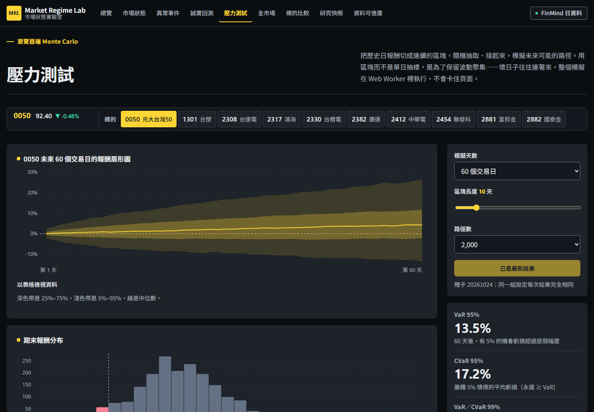
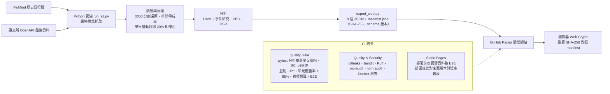

# Market Regime Lab

[](https://github.com/Lily09-project/market-anomaly-dashboard/actions/workflows/quality.yml)
[](https://github.com/Lily09-project/market-anomaly-dashboard/actions/workflows/security.yml)

用臺股歷史行情探索市場狀態、異常事件、回測風險與壓力情境的互動式研究網站，另附證交所全市場盤後一覽。研究用途，不構成投資建議。

**[開啟線上展示](https://lily09-project.github.io/market-anomaly-dashboard/)**

| 桌面版 | 手機版 |
| --- | --- |
|  |  |

## 3 分鐘 Demo 路線

每個連結都直接開到指定標的與參數，照順序點即可完成導覽。

1. **[市場狀態：0050](https://lily09-project.github.io/market-anomaly-dashboard/#/regimes?symbol=0050)**：看三狀態（平穩／震盪／高波動）時間軸、轉移矩陣與 1–3 狀態的 BIC 比較。重點：隱藏馬可夫模型以 NumPy 自行實作 Baum-Welch 與 Viterbi，跳空日先排除，不讓它自成一個狀態。
2. **[異常事件：0050 的 2025-04-07](https://lily09-project.github.io/market-anomaly-dashboard/#/events?symbol=0050&date=2025-04-07)**：選定這天的大跌，看它之後的累積異常報酬，再對照全部標的合計的事件研究。重點：偵測只用當時以前的資料，每季重新擬合、只對之後的區塊打分，沒有前視偏誤。
3. **[誠實回測：台積電 40／150 日均線](https://lily09-project.github.io/market-anomaly-dashboard/#/backtest?symbol=2330&cell=40)**：在 48 組參數熱圖中選定一格，對照樣本內、樣本外 Sharpe，再看 PBO 與 Deflated Sharpe。重點：回測不只報最好的數字，還量化「從一堆參數裡挑冠軍」有多不可靠。
4. **[壓力測試：0050 模擬 250 天、20,000 條路徑](https://lily09-project.github.io/market-anomaly-dashboard/#/stress?symbol=0050&horizon=250&block=20&paths=20000)**：開頁即開始模擬，進度條跑到一半按「取消」，再按「開始模擬」重跑。重點：區塊拔靴法在 Web Worker 執行，取消會直接終止 worker，畫面不卡；固定種子讓同一組設定每次結果相同。
5. **[資料可信度](https://lily09-project.github.io/market-anomaly-dashboard/#/data)**：看 8 個資料檔的 SHA-256 檢查全部通過，以及資料來源、涵蓋範圍與排除筆數。重點：瀏覽器用 Web Crypto 重新計算雜湊並對照 manifest，內容被截斷或竄改就拒絕顯示。

## 功能

- **標的比較**：以共同交易日比較兩檔收盤走勢、報酬、回撤與波動，可交換標的、分享指定交易日與下載 CSV。

- **10 檔深度分析**：0050 與台積電、鴻海、聯發科、台達電、廣達、富邦金、國泰金、中華電、台塑
  - 市場狀態偵測（隱藏馬可夫模型）與異常事件研究
  - 樣本內／樣本外回測與過度擬合檢查（PBO、Deflated Sharpe）
  - 可取消的瀏覽器端壓力測試
- **證交所盤後快照**：收盤價、成交值、本益比、殖利率、融資融券餘額與當月加權指數，並與 FinMind 收盤價交叉驗證
- **全市場盤後一覽**：約 1,300 多檔上市股票與 ETF，可搜尋、排序與篩選，條件保留在網址中
- **可驗證**：每個資料檔都在瀏覽器以 SHA-256 對照 manifest；研究快照可匯出、比對

## 畫面

版面採「研究報告 × 交易終端」：總覽是一份報告封面，列出資料截止日、跨標的的核心發現與閱讀順序；市場狀態、異常事件、誠實回測與壓力測試共用同一條標的工具列（桌面固定在頁首下方，手機改為可左右滑動的標的列），圖表居中、結論放在側欄；全市場頁是一張可捲動的盤後報價表。手機版的八個頁面以 4×2 格狀導覽呈現。

| 證交所盤後快照 | 全市場盤後一覽 |
| --- | --- |
|  |  |
| **市場狀態** | **異常事件** |
|  |  |
| **誠實回測** | **壓力測試** |
|  |  |

截圖取自正式網站的 FinMind 歷史快照與證交所盤後資料。改版上線後在 `web/` 執行 `npm run screenshots` 即可重拍，截圖清單在 `docs/screenshots/shots.json`。

## 正式資料

| 來源 | 內容 | 更新 |
| --- | --- | --- |
| [FinMind](https://finmind.github.io/Pricing/) 公開 API（免 token） | 10 檔 2021 年起的歷史日行情，供所有分析使用 | 平日台北時間 22:30 |
| [證交所 OpenAPI](https://openapi.twse.com.tw/)（免金鑰） | 最新一個交易日的盤後資料，涵蓋所有上市證券 | 同上 |

- 價格分析依官方公告還原 0050 的 2025-06-18 分割（1 拆 4）；其他標的若出現超過 20% 的單日變動（多半是未處理的分割或減資），建置會直接停止，不會把它當成崩跌發布。未再投入現金股息，屬價格報酬而非含息總報酬。
- FinMind 免費方案不帶 token 每小時最多 300 次，限非商業用途並須標示來源。證交所資料依[政府資料開放授權條款](https://data.gov.tw/license)使用。
- 證交所 OpenAPI 只提供最新資料，所以盤後快照與全市場頁不納入歷史分析；取得失敗時網站會標示「未取得」，不會因此停止發布價格分析。
- 固定種子的合成資料只用於本機研究、方法測試與 PR 預覽。正式 Pages 與 Docker 建置都必須以嚴格模式取得並驗證 FinMind 公開資料；來源失敗即停止，不會以合成資料替代。網站都是靜態快照，不是即時報價。

## 工程重點

Python、NumPy、React、TypeScript、Vite、Web Worker；GitHub Pages 提供靜態展示，另有非 root Docker 映像。介面採深色金黑配色與「研究報告 × 交易終端」排版，設計原則見 [DESIGN.md](DESIGN.md)。



- **資料一路可驗證**：匯出時為每個資料檔記錄 SHA-256 與 schema 版本；瀏覽器載入時重新計算，不符就顯示錯誤而不是畫出錯的數字。部署後的 smoke test 也會比對線上的 `deployment.json` 與每個 JS／CSS 資產的雜湊。
- **失敗就停止，不靜默替代**：正式建置以 `--require-api` 執行，來源取不到、分割邊界對不上或出現無法解釋的大幅跳動都會中止發布，合成資料只用於測試與 PR 預覽。
- **回測先防自欺**：48 組均線參數以 CSCV（資料切 10 塊、取 5 塊當樣本內，共 252 種組合）計算 PBO，再用 Deflated Sharpe 校正多重嘗試；選出的策略另有前視檢查，任何過去的部位若受未來價格影響，建置就直接報錯。
- **事件偵測只看過去**：每 63 個交易日用之前最多 504 天的報酬重新擬合 HMM，只對之後的區塊打分，z 值門檻 5。
- **瀏覽器與 Python 同一套引擎**：壓力測試的 TypeScript 版本與 Python 參考實作使用同一條 mulberry32 亂數序列與迴圈順序，由匯出的對照案例在測試中鎖定結果一致；計算放在 Web Worker，可隨時取消。
- **可重現**：CI 以合成資料連跑兩次完整管線，`diff -r` 兩份匯出必須完全相同；匯出數值先四捨五入，避免不同平台的浮點末位差異。

## 本機執行與驗證

需求：Python 3.12、Node.js 22。

```powershell
.\run_project.bat
.\run_project.bat --validate
```

方法、部署與驗收細節見 [方法說明](docs/METHODS.md)、[GitHub Pages](docs/GITHUB_PAGES.md)、[部署指南](docs/deployment.md)、[驗收標準](docs/ACCEPTANCE.md)及[安全政策](SECURITY.md)。
