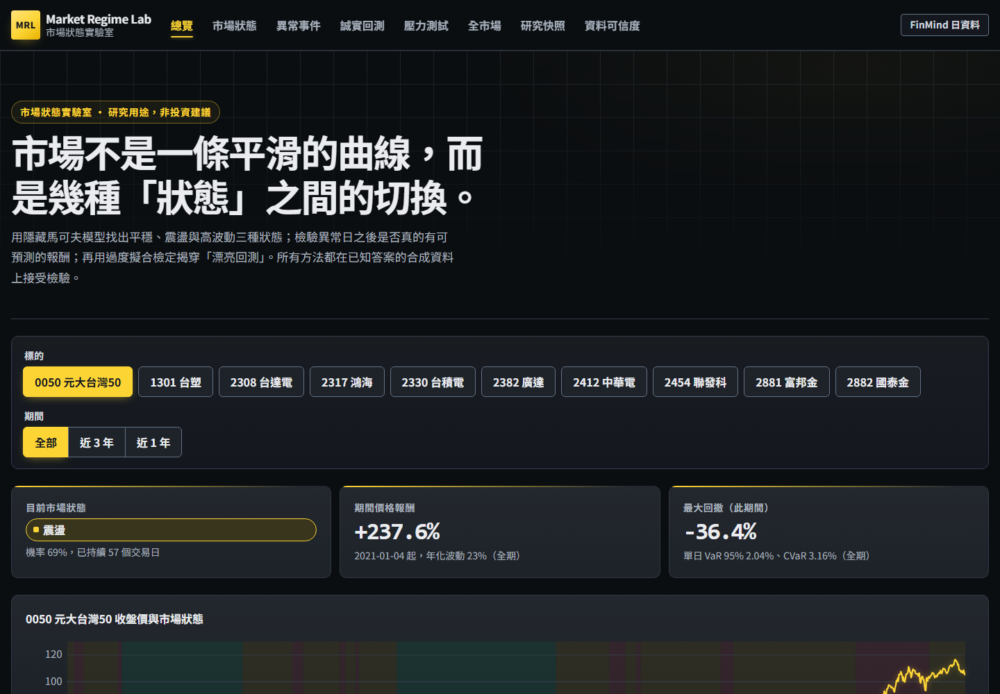
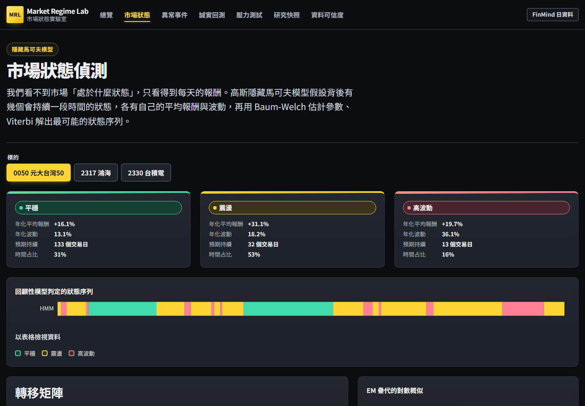
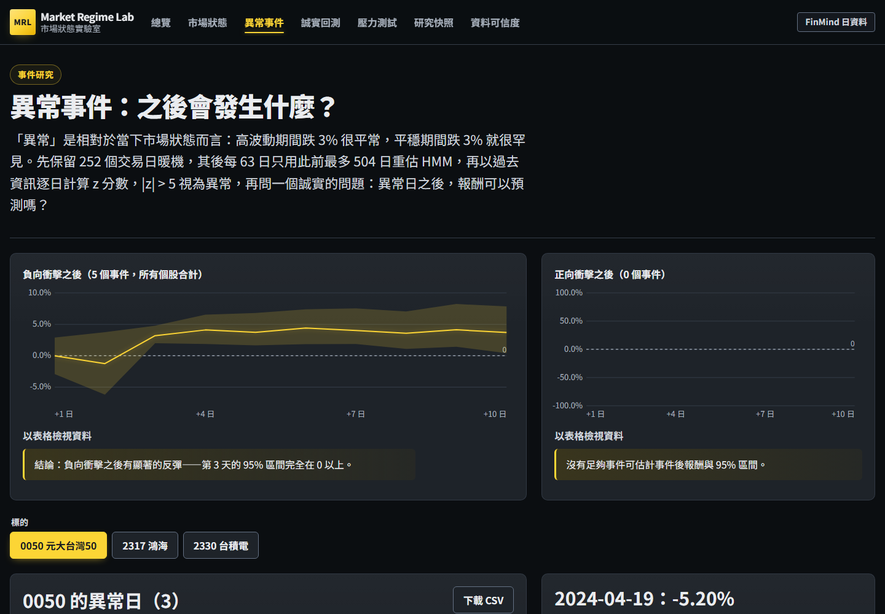
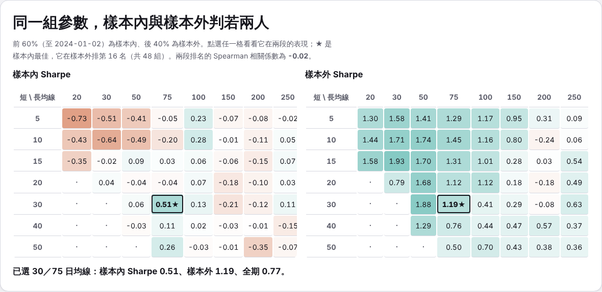
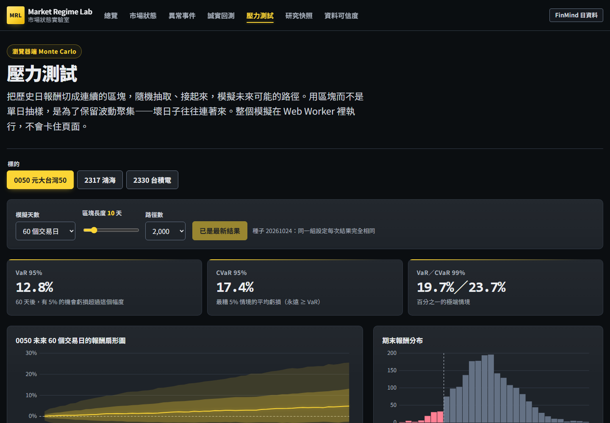

# Market Regime Lab

[](https://github.com/Lily09-project/market-anomaly-dashboard/actions/workflows/quality.yml)
[](https://github.com/Lily09-project/market-anomaly-dashboard/actions/workflows/security.yml)

用臺股歷史行情探索市場狀態、異常事件、回測風險與壓力情境的互動式研究網站。研究用途，不構成投資建議。

**[開啟線上展示](https://lily09-project.github.io/market-anomaly-dashboard/)**



## 功能

- 市場狀態偵測與異常事件研究
- 樣本內／樣本外回測與過度擬合檢查
- 可取消的瀏覽器端風險模擬
- 研究快照匯出、比對與完整性驗證

## 正式資料

價格分析依官方公告還原 0050 的 2025-06-18 分割（1 拆 4）；未再投入現金股息，屬價格報酬而非含息總報酬。原始 OHLCV 與分析輸入分開保留，來源列於網站「資料可信度」。

正式網站使用 FinMind 公開 API 的臺股歷史日行情（0050、2330、2317），經驗證後以靜態快照發布；不是即時報價。免費方案不帶 token 每小時最多 300 次，限非商業用途並須標示來源；詳見 [FinMind 官方方案與授權](https://finmind.github.io/Pricing/)。

首頁另有「證交所盤後快照」，資料來自免金鑰的 [證交所 OpenAPI](https://openapi.twse.com.tw/)，依[政府資料開放授權條款](https://data.gov.tw/license)使用。內容包含最新一個交易日的收盤價、成交值、本益比、殖利率、融資融券餘額，以及當月加權指數，並以證交所收盤價交叉驗證 FinMind 的未還原收盤價。OpenAPI 只提供最新資料，所以這區只是補充快照，不納入歷史分析；取得失敗時網站會標示「未取得」，不會因此停止發布價格分析。

固定種子的合成資料只用於本機研究、方法測試與 PR 預覽。正式 Pages 與 Docker 建置都必須以嚴格模式取得並驗證 FinMind 公開資料；來源失敗即停止，不會以合成資料替代。Docker 內含建置當時的靜態快照，執行中的網站不會即時連外。

## 技術

Python、NumPy、React、TypeScript、Vite、Web Worker；GitHub Pages 提供靜態展示，另有非 root Docker 映像。介面採深色金黑研究工作區，設計原則見 [DESIGN.md](DESIGN.md)。

## 畫面

| 市場狀態 | 異常事件 |
| --- | --- |
|  |  |
| **誠實回測** | **壓力測試** |
|  |  |

截圖取自正式網站的 FinMind 歷史快照。

## 本機執行與驗證

需求：Python 3.12、Node.js 22。

```powershell
.\run_project.bat
.\run_project.bat --validate
```

方法、部署與驗收細節見 [方法說明](docs/METHODS.md)、[GitHub Pages](docs/GITHUB_PAGES.md)、[部署指南](docs/deployment.md)、[驗收標準](docs/ACCEPTANCE.md)及[安全政策](SECURITY.md)。
