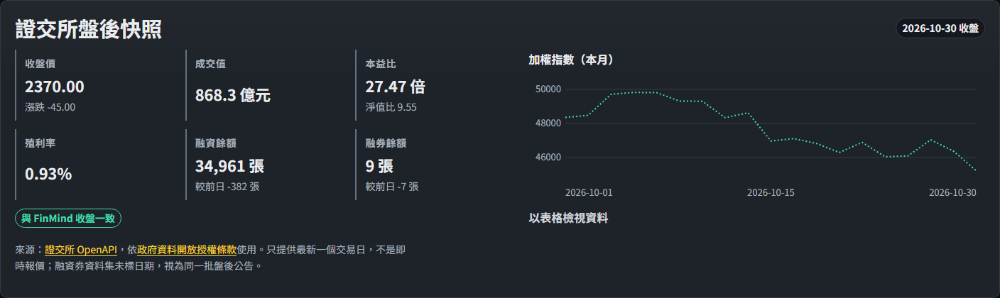
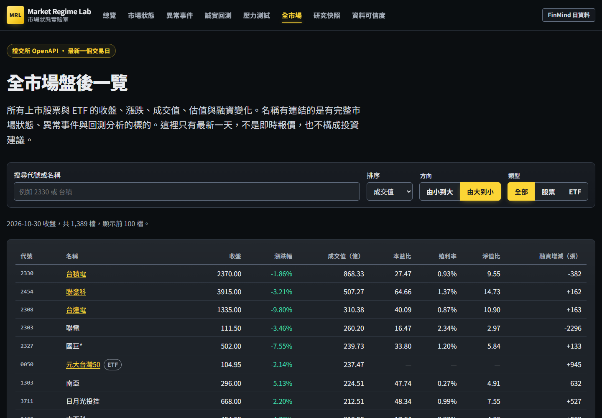

# Market Regime Lab

[](https://github.com/Lily09-project/market-anomaly-dashboard/actions/workflows/quality.yml)
[](https://github.com/Lily09-project/market-anomaly-dashboard/actions/workflows/security.yml)

用臺股歷史行情探索市場狀態、異常事件、回測風險與壓力情境的互動式研究網站，另附證交所全市場盤後一覽。研究用途，不構成投資建議。

**[開啟線上展示](https://lily09-project.github.io/market-anomaly-dashboard/)**

| 桌面版 | 手機版 |
| --- | --- |
|  |  |

## 功能

- **10 檔深度分析**：0050 與台積電、鴻海、聯發科、台達電、廣達、富邦金、國泰金、中華電、台塑
  - 市場狀態偵測（隱藏馬可夫模型）與異常事件研究
  - 樣本內／樣本外回測與過度擬合檢查（PBO、Deflated Sharpe）
  - 可取消的瀏覽器端壓力測試
- **證交所盤後快照**：收盤價、成交值、本益比、殖利率、融資融券餘額與當月加權指數，並與 FinMind 收盤價交叉驗證
- **全市場盤後一覽**：約 1,300 多檔上市股票與 ETF，可搜尋、排序與篩選，條件保留在網址中
- **可驗證**：每個資料檔都在瀏覽器以 SHA-256 對照 manifest；研究快照可匯出、比對

## 畫面

| 證交所盤後快照 | 全市場盤後一覽 |
| --- | --- |
|  |  |
| **市場狀態** | **異常事件** |
|  |  |
| **誠實回測** | **壓力測試** |
|  |  |

截圖取自正式網站的 FinMind 歷史快照與證交所盤後資料。

## 正式資料

| 來源 | 內容 | 更新 |
| --- | --- | --- |
| [FinMind](https://finmind.github.io/Pricing/) 公開 API（免 token） | 10 檔 2021 年起的歷史日行情，供所有分析使用 | 平日台北時間 22:30 |
| [證交所 OpenAPI](https://openapi.twse.com.tw/)（免金鑰） | 最新一個交易日的盤後資料，涵蓋所有上市證券 | 同上 |

- 價格分析依官方公告還原 0050 的 2025-06-18 分割（1 拆 4）；其他標的若出現超過 20% 的單日變動（多半是未處理的分割或減資），建置會直接停止，不會把它當成崩跌發布。未再投入現金股息，屬價格報酬而非含息總報酬。
- FinMind 免費方案不帶 token 每小時最多 300 次，限非商業用途並須標示來源。證交所資料依[政府資料開放授權條款](https://data.gov.tw/license)使用。
- 證交所 OpenAPI 只提供最新資料，所以盤後快照與全市場頁不納入歷史分析；取得失敗時網站會標示「未取得」，不會因此停止發布價格分析。
- 固定種子的合成資料只用於本機研究、方法測試與 PR 預覽。正式 Pages 與 Docker 建置都必須以嚴格模式取得並驗證 FinMind 公開資料；來源失敗即停止，不會以合成資料替代。網站都是靜態快照，不是即時報價。

## 技術

Python、NumPy、React、TypeScript、Vite、Web Worker；GitHub Pages 提供靜態展示，另有非 root Docker 映像。介面採深色金黑研究工作區，設計原則見 [DESIGN.md](DESIGN.md)。

## 本機執行與驗證

需求：Python 3.12、Node.js 22。

```powershell
.\run_project.bat
.\run_project.bat --validate
```

方法、部署與驗收細節見 [方法說明](docs/METHODS.md)、[GitHub Pages](docs/GITHUB_PAGES.md)、[部署指南](docs/deployment.md)、[驗收標準](docs/ACCEPTANCE.md)及[安全政策](SECURITY.md)。
