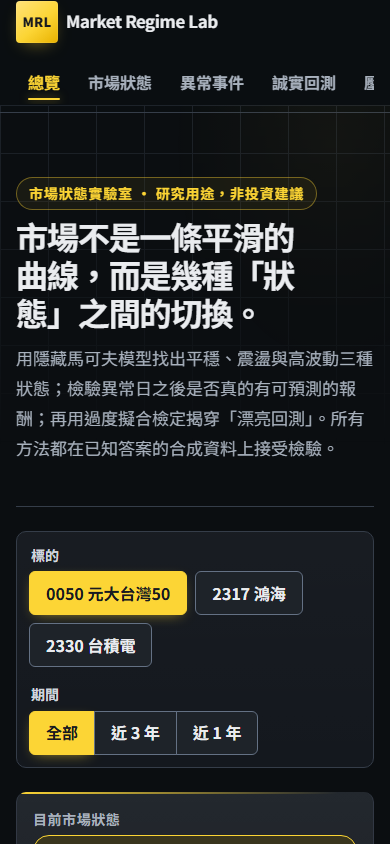
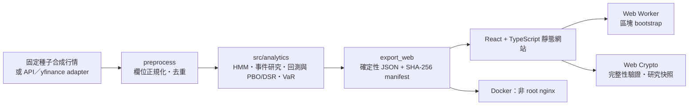

# Market Regime Lab — 市場狀態實驗室

[](https://github.com/Lily09-project/market-anomaly-dashboard/actions/workflows/quality.yml)
[](https://github.com/Lily09-project/market-anomaly-dashboard/actions/workflows/security.yml)

> 一個「不會騙你」的量化研究實驗室：找出市場處於哪一種狀態、檢驗異常日之後是否真的有可預測的報酬、揭穿漂亮回測背後的過度擬合，並在瀏覽器裡做壓力測試。研究與教學用途，**不構成任何投資建議**。

**[▶ 開啟線上實驗室](https://lily09-project.github.io/market-anomaly-dashboard/)**：純靜態網站，所有模擬都在你的瀏覽器裡執行。


## 為什麼做這個

多數「股票分析儀表板」只畫 K 線與技術指標，而大多數回測文章只展示樣本內最漂亮的那條淨值曲線。這個專案反過來：**每個方法都先在已知答案的資料上驗證，再誠實呈現它在樣本外的表現。**

展示站使用固定種子的合成行情，刻意放進三種已知結構：一條全市場的狀態鏈（平穩／震盪／高波動）、每檔 20 個跳空事件（負向跳空後 3 天有已知的反彈），以及一條去除平均值的隨機漫步當作對照組。分析程式不知道答案，網站卻把結果與答案並排。

## 六個實驗

| 實驗 | 回答的問題 | 方法（numpy 自行實作） | 驗證結果 |
| --- | --- | --- | --- |
| **市場狀態偵測** | 現在是平穩、震盪還是高波動？會持續多久？ | 高斯隱藏馬可夫模型：縮放的前向後向、Baum-Welch、多組初始化、Viterbi；跳空日視為缺值；BIC 比較 1–3 個狀態 | 真實狀態還原準確率 87%–92%（門檻 80%）；對照組 BIC 正確地選 1 個狀態 |
| **異常事件研究** | 異常日之後的報酬可以預測嗎？ | 以 HMM 一步預測（只用過去）計算 z 分數；平均調整模型的 CAR；重抽事件的 bootstrap 95% 區間 | 注入跳空召回率 83%、精確率 98%；找回負向衝擊後的反彈（+3 日 CAR 1.5%，區間 [0.5%, 2.4%]，真實值 1.2%）；正向衝擊正確地不顯著；對照組 0 誤報 |
| **誠實回測** | 「最佳參數」是真本事還是運氣？ | 48 組均線交叉、樣本內／樣本外熱力圖、walk-forward、CSCV 計算 PBO、Deflated Sharpe Ratio、前視偏誤自動檢查 | 0050 樣本內最佳 Sharpe 0.78 → walk-forward 樣本外 −0.34；隨機漫步上 PBO 平均 ≥ 0.4、含真實訊號時明顯較低（單元測試） |
| **壓力測試** | 未來 60 天最糟會虧多少？ | 區塊 bootstrap 在 Web Worker 執行、可取消；扇形圖、VaR／CVaR 95%／99% | TypeScript 引擎與 Python 參考實作逐位一致（共用 mulberry32，誤差 < 1e-9） |
| **研究快照** | 怎麼證明一份分析結果沒被改過？ | 資料指紋＋參數＋結果的 canonical JSON，以 SHA-256 簽名；匯入時驗證結構、大小與指紋並逐項比較 | 竄改任何數字都會被拒絕並說明原因（E2E） |
| **資料可信度** | 數字從哪來、能重現嗎？ | 確定性匯出＋manifest、瀏覽器端 SHA-256 驗證 | CI 連跑兩次 `diff -r` 完全相同 |

<table>
  <tr>
    <td></td>
    <td></td>
  </tr>
  <tr>
    <td></td>
    <td></td>
  </tr>
  <tr>
    <td colspan="2"></td>
  </tr>
</table>

## 架構



- **資料科學**：所有演算法在 `src/analytics/` 以 numpy 自行實作（不使用 hmmlearn、statsmodels 等黑盒），每個都有手算小例子與「能否找回已知答案」的測試。
- **後端工程**：一條指令完成資料、分析與匯出；匯出不讀系統時間、固定種子、鍵排序；多階段 Docker 映像以非 root nginx 提供網站並附健康檢查與安全標頭。
- **前端**：React 19 + TypeScript + Vite、d3-scale 手寫 SVG（依容器寬度量測）、可點選的參數熱力圖、Web Worker 模擬可取消並顯示進度、Hash 路由保存標的與參數、淺色／深色主題；首屏 JS 86 KB（gzip）。
- **可及性與安全**：每張圖都有等價資料表、熱力圖格子是可聚焦的按鈕、axe-core 零 serious/critical；嚴格 CSP、無 inline script、執行期不呼叫第三方；快照匯入有大小、結構與指紋驗證。

## 本機啟動

需求：Python 3.12、Node.js 22。

**Windows**

```powershell
git clone https://github.com/Lily09-project/market-anomaly-dashboard.git
cd market-anomaly-dashboard
.\run_project.bat            # 產生資料、跑測試、建置並開啟 http://127.0.0.1:4173
.\run_project.bat --validate # 只跑全部檢查，不啟動網站
```

**macOS／Linux**

```bash
python3.12 -m venv .venv && .venv/bin/pip install -r requirements-dev.lock.txt
.venv/bin/python run_all.py --mode sample
cd web && npm ci && npm run build && npm run preview
```

**Docker**

```bash
docker build -t market-regime-lab . && docker run --rm -p 8080:8080 market-regime-lab   # http://127.0.0.1:8080
```

## 測試與驗收

驗收標準在重做開始前就訂在 [docs/ACCEPTANCE.md](docs/ACCEPTANCE.md)：

| 層級 | 指令 | 標準 |
| --- | --- | --- |
| Python 分析 | `python -W error -m pytest -q --cov=src.analytics --cov=src.export_web --cov-fail-under=90` | 全數通過；覆蓋率 ≥ 90%（目前 99%） |
| 前端邏輯 | `npm run typecheck && npm run lint && npm run coverage` | 0 錯誤；`web/src/lib` 覆蓋率 ≥ 85%；含 TS／Python 壓力測試一致性與快照竄改測試 |
| 端對端 | `npm run e2e` | 4 種組合（1440 淺色／深色、768、390）× F1–F7 旅程與品質檢查，含 axe、鍵盤、0 console error |
| 效能 | `npm run size` | 首屏 JS ≤ 200 KB、首屏資料 ≤ 800 KB |
| 安全與容器 | `ruff`、`bandit`、`pip-audit`、`npm audit`、gitleaks、CI 建置映像並檢查健康與 CSP 標頭 | 無問題 |

## 限制

- 合成資料讓方法可以被驗證，真實市場的結構更複雜、也會變；這裡的數字不代表任何真實股票。
- 回測忽略滑價、流動性、稅與融資限制。
- VaR 只描述歷史報酬重組後的分布，無法涵蓋沒發生過的危機。
- 本站不提供投資建議或交易訊號。

方法細節見 [docs/METHODS.md](docs/METHODS.md)，部署見 [docs/deployment.md](docs/deployment.md)、[docs/GITHUB_PAGES.md](docs/GITHUB_PAGES.md)，安全通報見 [SECURITY.md](SECURITY.md)。
